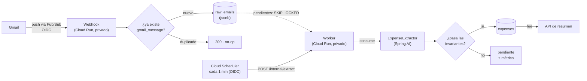

# expense-tracker

Backend de un tracker de gastos que se alimenta solo: recibe los push de Gmail, extrae el gasto,
lo guarda normalizado en PostgreSQL y lo expone en una API de resumen.

Está diseñado como un sistema de producción, no como un proyecto personal: webhooks idempotentes,
extracción determinística por plantilla con un LLM como fallback, y un guard que impide que el modelo
invente un monto. Reintentos con dead letter, evals medidas sobre lo que el modelo decide, costo por
correo y alertas con runbook. Cada decisión tiene su ADR para poder defenderla en voz alta.

> **Estado:** diseño cerrado, implementación pendiente. Este repositorio contiene por ahora la
> documentación de arquitectura; el código entra en slices verticales con TDD.

**Stack:** Java 25 (LTS) · Spring Boot 4.2 · PostgreSQL · Flyway · Spring AI 2.1 · Testcontainers ·
Pub/Sub · Cloud Run · GitHub Actions.

---

## Arquitectura



Tres ideas sostienen el diseño:

1. **El webhook no piensa.** Responde `200` solo después de guardar el correo crudo; `5xx` cuando no
   puede, para que Pub/Sub reintente. Un LLM dentro del request es una garantía de timeouts y
   duplicados.
2. **El crudo se guarda antes de interpretarlo.** Un cambio de prompt se reprocesa sobre lo
   guardado, sin volver a pedirle nada a Gmail.
3. **La idempotencia es una clave única** (`raw_emails.gmail_message` por cuenta), no un `if` en
   memoria.
4. **La tabla es la cola.** Pub/Sub solo trae el aviso; el trabajo pendiente vive en `raw_emails` y el
   worker lo toma con `SKIP LOCKED`. No hay dos registros del mismo trabajo que puedan desincronizarse
   (ADR 0008).
5. **El dinero no lo decide el modelo.** Las plantillas resuelven el formato conocido; el LLM entra solo
   cuando no hay plantilla, y un `MoneyGuard` exige que el monto aparezca literalmente en el correo. Si
   no aparece, el gasto no se crea: queda en revisión (ADR 0014).

## Decisiones

| # | Decisión | Por qué |
|---|---|---|
| [0001](docs/decisions/0001-java-25-spring-boot-4.md) | Java 25 + Spring Boot 4.2 | LTS vigente y el mayor volumen de ofertas backend en Chile |
| [0002](docs/decisions/0002-flyway-not-liquibase.md) | Flyway con `ddl-auto: validate` | El esquema es SQL revisable; Hibernate solo valida |
| [0003](docs/decisions/0003-raw-emails-and-idempotency.md) | Correo crudo antes de extraer | Reprocesable y sin pérdida de datos |
| [0004](docs/decisions/0004-llm-behind-expense-extractor.md) | LLM detrás de `ExpenseExtractor` | Sin lock-in, testeable con un fake |
| [0005](docs/decisions/0005-deploy-cloud-run.md) | Cloud Run + Pub/Sub con OIDC | El push ya vive en GCP; el endpoint queda privado |
| [0006](docs/decisions/0006-multi-tenant-from-v1.md) | `account_id` desde V1 | Multi-tenant retroactivo es una migración de terror |
| [0007](docs/decisions/0007-ingestion-resilience.md) | Ingesta resiliente | El watch vence a los 7 días y falla en silencio |
| [0008](docs/decisions/0008-worker-triggered-by-scheduler.md) | Pub/Sub solo como transporte de entrada | La tabla es la cola: una sola fuente de verdad |
| [0009](docs/decisions/0009-indexes-and-partitioning.md) | Índices parciales, particiones diferidas | Particionar rompería la unicidad de `gmail_message` |
| [0010](docs/decisions/0010-api-authentication.md) | API key por cuenta | Sin auth, el rate limiting protege el cupo, no los datos |
| [0011](docs/decisions/0011-dedupe-survives-purge.md) | El gasto guarda su `gmail_message` | La unicidad no puede depender de una fila que se purga |
| [0012](docs/decisions/0012-quota-enforcement.md) | La cuota bloquea la extracción, no la ingesta | Un correo recibido no se descarta nunca |
| [0013](docs/decisions/0013-categories-and-locale.md) | Categorías del usuario, moneda e idioma por cuenta | La home es el gasto del mes por categoría: el texto libre la rompe |
| [0014](docs/decisions/0014-templates-first-llm-fallback.md) | Plantillas primero, LLM como fallback, monto validado | Un monto inventado es indistinguible de uno real |
| [0015](docs/decisions/0015-auditable-enrichment.md) | Enriquecimiento con `origin` auditable | Sin saber quién decidió, no hay forma de medir |

## Documentación

- [`docs/architecture.md`](docs/architecture.md) — contexto, secuencia de un correo, modelo de datos.
- [`docs/roadmap.md`](docs/roadmap.md) — incrementos por fase, con el gate de salida de cada una.
- [`docs/decisions/`](docs/decisions/) — ADRs, uno por decisión, con estado.
- [`docs/operations.md`](docs/operations.md) — deploy, alertas y runbooks, costos, límites de Google.
- [`docs/privacy.md`](docs/privacy.md) — qué se guarda, para qué, hasta cuándo y quién lo trata.
- [`docs/ui.md`](docs/ui.md) — qué se muestra: home por categoría, estados y contrato con el backend.
- [`docs/evals.md`](docs/evals.md) — dataset, métrica y resultados medidos.

## Cómo se corre

```bash
docker run -d --name expense-pg -p 5432:5432 \
  -e POSTGRES_DB=expense -e POSTGRES_USER=expense -e POSTGRES_PASSWORD=expense \
  postgres:18-alpine
mvn spring-boot:run          # Flyway aplica V1 al arrancar
mvn verify                   # tests + integración (Testcontainers, requiere Docker)
```

El webhook escucha en `POST /gmail/notifications` y **exige un token OIDC de Google** con la audiencia
`PUBSUB_AUDIENCE` y el email `PUBSUB_SERVICE_ACCOUNT`. Sin esos dos valores correctos devuelve `401`.

## Números medidos

| Qué | Valor (3 corridas) | Cómo |
|---|---|---|
| p50 del webhook | 66–93 ms | 50 concurrentes × 10 envíos, Postgres en Docker local |
| p95 del webhook | **393–631 ms** | mismo gate; dominado por commits concurrentes con el pool por defecto |

Medido en `IngestLatencyTest`. **No es el número de Cloud Run**: ahí se suma el salto de red, pero también
hay pool gestionado y disco distinto. El valor de la cifra es que es reproducible y que cualquier
regresión aparece en CI.

## Fuera de alcance

- Sincronización bancaria y conciliación de cartolas (fases 4 y 5 del roadmap).
- UI propia: el entregable es la API; un front iría en otro repositorio.
- Facturación: el diseño deja lugar (`account_id`, cuotas por cuenta), pero no se implementa todavía.
