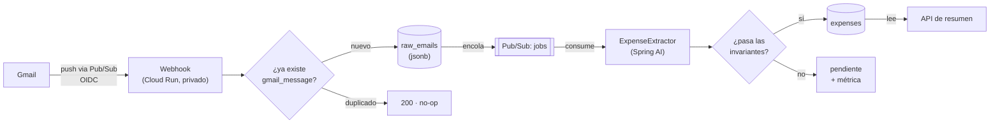

# expense-tracker

Backend de un tracker de gastos que se alimenta solo: recibe los push de Gmail, extrae el gasto con
un LLM, lo guarda normalizado en PostgreSQL y lo expone en una API de resumen.

Está diseñado como un sistema de producción, no como un proyecto personal: webhooks idempotentes,
extracción no determinística validada, reintentos con dead letter, evals medidas, costo por correo y
alertas con runbook. Cada decisión tiene su ADR para poder defenderla en voz alta.

> **Estado:** diseño cerrado, implementación pendiente. Este repositorio contiene por ahora la
> documentación de arquitectura; el código entra en slices verticales con TDD.

**Stack:** Java 25 (LTS) · Spring Boot 4.2 · PostgreSQL · Flyway · Spring AI 2.1 · Testcontainers ·
Pub/Sub · Cloud Run · Cloudflare · GitHub Actions.

---

## Arquitectura

Tres ideas sostienen el diseño:

1. **El webhook no piensa.** Responde `200` solo después de guardar el correo crudo; `5xx` cuando no
   puede, para que Pub/Sub reintente. Un LLM dentro del request es una garantía de timeouts y
   duplicados.
2. **El crudo se guarda antes de interpretarlo.** Un cambio de prompt se reprocesa sobre lo
   guardado, sin volver a pedirle nada a Gmail.
3. **La idempotencia es una clave única** (`raw_emails.gmail_message` por cuenta), no un `if` en
   memoria.

## Decisiones

| # | Decisión | Por qué |
|---|---|---|
| [0001](docs/decisions/0001-java-25-spring-boot-4.md) | Java 25 + Spring Boot 4.2 | LTS vigente y el mayor volumen de ofertas backend en Chile |
| [0002](docs/decisions/0002-flyway-not-liquibase.md) | Flyway con `ddl-auto: validate` | El esquema es SQL revisable; Hibernate solo valida |
| [0003](docs/decisions/0003-raw-emails-and-idempotency.md) | Correo crudo antes de extraer | Reprocesable y sin pérdida de datos |
| [0004](docs/decisions/0004-llm-behind-expense-extractor.md) | LLM detrás de `ExpenseExtractor` | Sin lock-in, testeable con un fake |
| [0005](docs/decisions/0005-deploy-cloud-run.md) | Cloud Run + Pub/Sub con OIDC | El push ya vive en GCP; el endpoint queda privado |
| [0006](docs/decisions/0006-multi-tenant-from-v1.md) | `account_id` desde V1 | Multi-tenant retroactivo es una migración de terror |
| [0007](docs/decisions/0007-ingestion-resilience.md) | Ingesta resiliente | El watch vence a los 7 días y falla en silencio |

## Documentación

- [`docs/architecture.md`](docs/architecture.md) — contexto, secuencia de un correo, modelo de datos.
- [`docs/decisions/`](docs/decisions/) — ADRs, uno por decisión, con estado.
- [`docs/operations.md`](docs/operations.md) — deploy, alertas y runbooks, costos, límites de Google.
- [`docs/evals.md`](docs/evals.md) — dataset, métrica y resultados medidos.

## Cómo se corre

Cuando exista el primer slice: `docker compose up -d` levanta PostgreSQL y `mvn spring-boot:run` la
aplicación; `mvn verify` corre unitarios e integración (Testcontainers, requiere Docker).

## Fuera de alcance

- Sincronización bancaria y conciliación de cartolas.
- UI propia: el entregable es la API; un front iría en otro repositorio.
- Facturación: el diseño deja lugar (`account_id`, cuotas por cuenta), pero no se implementa todavía.
