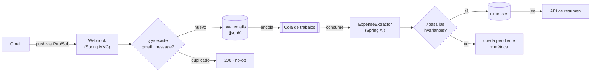
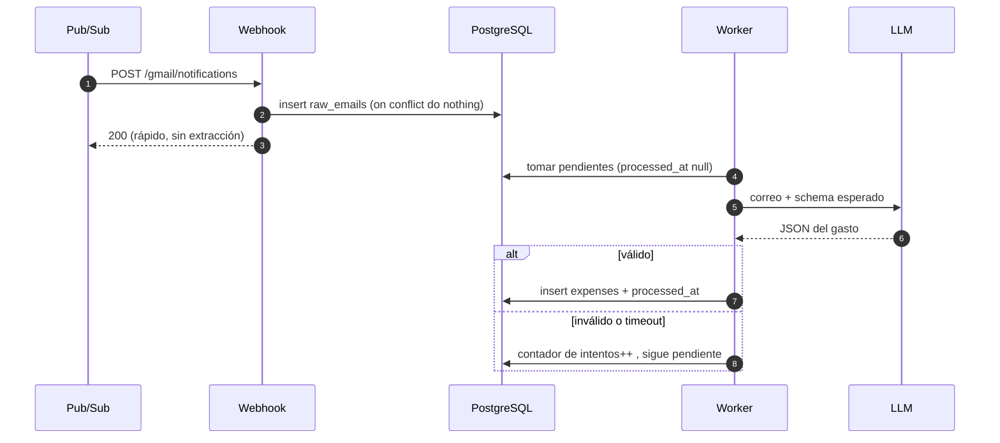
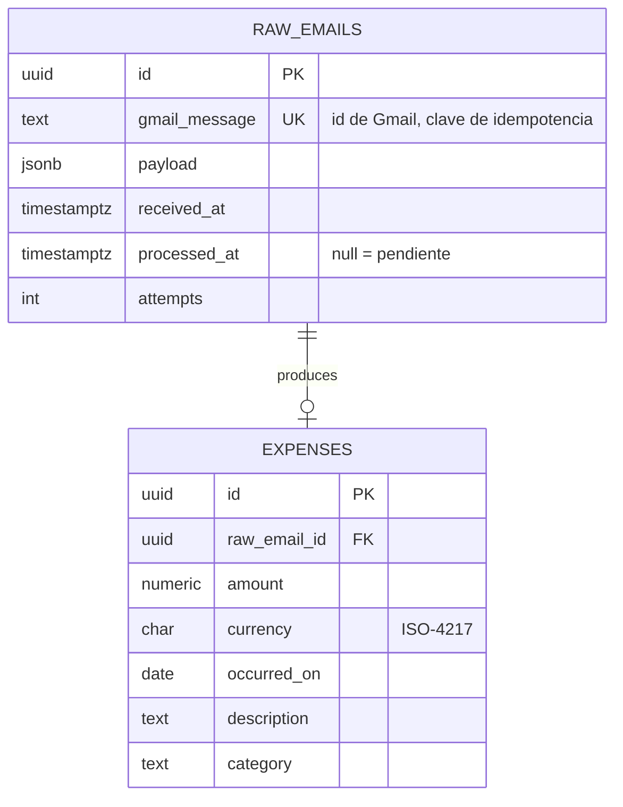

# expense-tracker

Backend de un tracker personal de gastos que se alimenta solo: lee los correos de Gmail, extrae el
gasto con un LLM, lo guarda normalizado en PostgreSQL y lo expone en una API de resumen.

El objetivo no es "anotar gastos". Es tener el sistema completo que hoy piden las ofertas de
software con IA en producción: **webhooks idempotentes, extracción no determinística validada,
reintentos, evals medidas y costo por correo**. Cada decisión de diseño está escrita como ADR, para
poder defenderla en voz alta.

> **Estado:** diseño. Todavía no hay código; este documento es el contrato antes de escribirlo.

**Stack:** Java 25 (LTS) · Spring Boot 4.2 · PostgreSQL 18 · Flyway · Spring AI 2.1 · Testcontainers · GitHub Actions.

---

## Arquitectura

Tres ideas sostienen el diagrama:

1. **El webhook no piensa.** Responde `200` apenas guarda el correo crudo. Pub/Sub reintenta todo lo
   que no sea `2xx`, así que un LLM adentro del request es una garantía de duplicados y timeouts.
2. **El correo crudo se guarda antes de interpretarlo.** Un cambio de prompt o de modelo se
   reprocesa sobre lo guardado, sin volver a pedirle nada a Google.
3. **La idempotencia es una clave única,** no un `if` en memoria: `raw_emails.gmail_message` es
   `unique` y el insert es `on conflict do nothing`.

### Flujo de un correo

### Modelo de datos

---

## Decisiones de diseño

| Decisión | Por qué |
|---|---|
| **Java 25 + Spring Boot 4.2** | Java/Spring es el mayor volumen de ofertas backend en Chile (158 vs 12 Kotlin en Computrabajo al 23-nov-2026) y Spring Boot 4.2 soporta la LTS vigente. |
| **Flyway con `ddl-auto: validate`** | El esquema es SQL revisable en el PR. Hibernate solo valida: si el código y la base divergen, el arranque falla en vez de corromper datos. |
| **Correo crudo antes de extraer** | Permite reprocesar y medir sin depender de Gmail; el fallo de extracción nunca pierde el dato. |
| **`ExpenseExtractor` como puerto** | El LLM es la pieza no determinística: va detrás de una interfaz con implementación Spring AI, otra con SDK directo y un fake para tests sin red ni tokens. |
| **Validación en tipos, no en el prompt** | Si el JSON no respeta las invariantes del dominio, no se escribe nada: se reintenta y se cuenta. |
| **Evals con umbral en CI** | La única forma honesta de saber si un cambio de prompt mejora: mismo dataset, misma métrica, build rojo si baja. |

## Cómo se mide (lo que lo hace "de producción")

- **Precisión de extracción** sobre un set etiquetado de correos reales anonimizados: monto, moneda y
  fecha correctos. Métrica publicada en el README, no en la cabeza del autor.
- **Tasa de duplicados absorbidos** por la clave de idempotencia.
- **Latencia p95 y costo por correo** (tokens in/out × precio del modelo), visibles en Actuator.

## Fuera de alcance

- Sincronización bancaria (otra integración, otro problema).
- Multiusuario y autenticación de producto: es un tracker personal.
- UI propia: la API de resumen es el entregable; un front, si aparece, va en otro repo.
