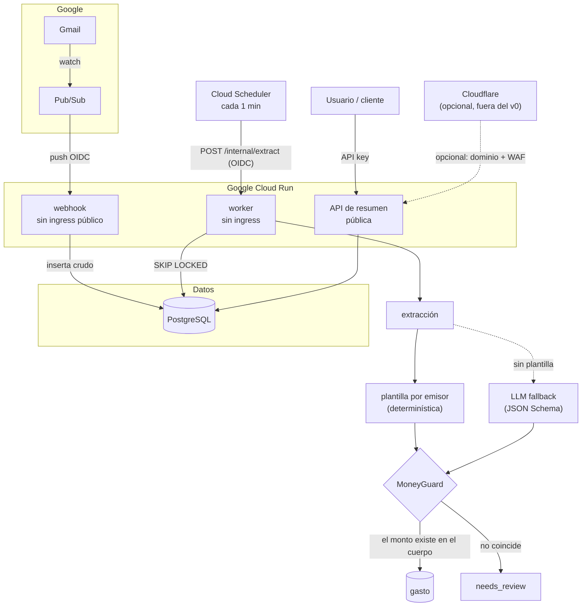
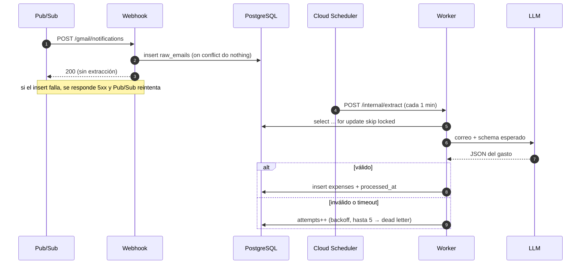
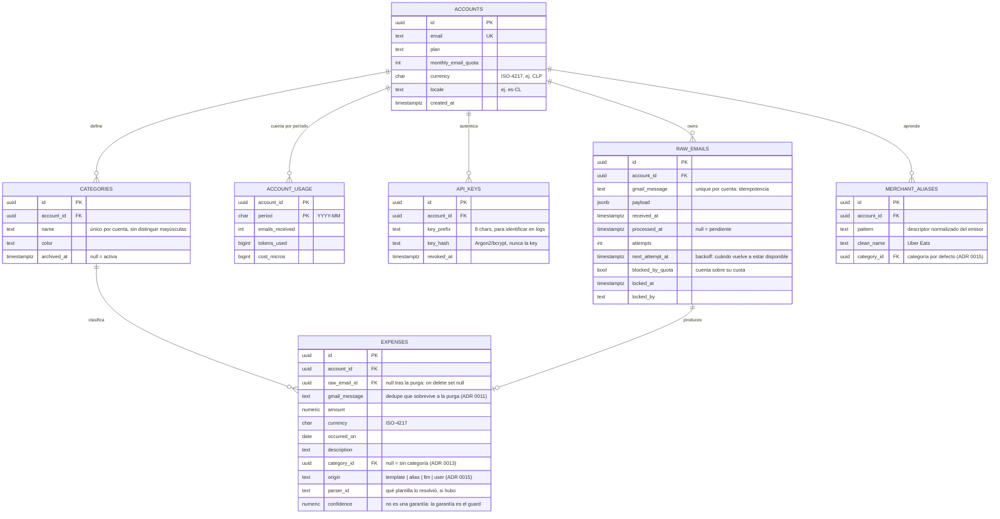

# Arquitectura

Este documento describe **cómo está armado** el sistema. Las decisiones y su justificación viven en
[`decisions/`](decisions/); acá solo se describe el resultado.

## Contexto



## Flujo de un correo



### Prefiltro de correos

El push avisa de **cada** correo del buzón, así que el sistema elige qué mirar antes de descargar nada
(ADR 0017):

1. Del aviso se pide **solo cabeceras** (`format=metadata`): remitente y asunto. Sin cuerpo.
2. Deciden reglas: dominios de bancos, tarjetas y comercios conocidos, más palabras de transacción en el
   asunto ("compra", "cargo", "boleta", "factura", "pago").
3. Solo el candidato se descarga, se **enmascara** (RUT, tarjeta, emails, teléfonos, titular) y se guarda.
4. Lo descartado no se guarda: ni cuerpo, ni asunto, ni remitente. Solo un contador.

El riesgo es el opuesto al habitual: un filtro angosto **pierde gastos en silencio**. Por eso la lista es
generosa, se mide la ratio guardado/recibido y hay alerta si cae.

## Modelo de datos



Notas que importan más que las columnas:

- **La clave de idempotencia es por cuenta**: `(account_id, gmail_message)` único.
- `expenses` guarda también `gmail_message`: la deduplicación sobrevive a la purga del crudo (ADR 0011).
- `attempts`, `next_attempt_at`, `blocked_by_quota`, `locked_at` y `locked_by` existen para que el
  worker reintente con backoff, respete la cuota (ADR 0012) y no bloquee la fila si muere.
- `payload` en `jsonb` guarda el correo completo: es el insumo de la reprocesabilidad y de las evals.

### Cómo evoluciona el modelo

Este diagrama describe **el v0**: una sola fuente y un gasto por correo. Desde la Fase 4 el contenedor
pasa a `raw_documents` con `kind` (`email`, `statement`, `receipt`, `image`), el gasto se vincula a varios
documentos y cada campo tiene una fuente autoritativa (ADR 0016, `docs/roadmap.md`). No se adelanta acá
para no documentar como hecho algo que todavía no está construido.

## Índices y retención

Los índices no son decoración: cada uno existe porque hay una consulta que lo usa. Los que el flujo
necesita desde V1:

```sql
-- idempotencia: una fila por correo y cuenta
create unique index raw_emails_message_uk on raw_emails (account_id, gmail_message);

-- consulta del worker (cada minuto). PARCIAL: solo indexa lo que está vivo
create index raw_emails_pending_idx on raw_emails (next_attempt_at)
  where processed_at is null and attempts < 5;

-- cuotas y consultas por cuenta
create index raw_emails_account_received_idx on raw_emails (account_id, received_at desc);

-- purga por retención: BRIN, porque la tabla es append-only
create index raw_emails_received_brin on raw_emails using brin (received_at);

-- una sola extracción por correo, aunque el worker reintente
create unique index expenses_raw_email_uk on expenses (raw_email_id)
  where raw_email_id is not null;

-- resumen mensual por cuenta
create index expenses_account_date_idx on expenses (account_id, occurred_on desc);

-- la consulta de la home: gasto del mes agrupado por categoría (ADR 0013)
create index expenses_account_category_idx on expenses (account_id, category_id, occurred_on desc);

-- categorías activas de una cuenta, sin duplicados por mayúsculas
create unique index categories_name_uk on categories (account_id, lower(name));

-- un alias por descriptor y cuenta: la segunda vez ya no llama al modelo (ADR 0015)
create unique index merchant_aliases_pattern_uk on merchant_aliases (account_id, pattern);
```

**Por qué parcial y no completo:** un índice sobre `processed_at` se degrada porque casi todas las filas
terminan procesadas; el parcial indexa solo pendientes y se mantiene en kilobytes con cualquier volumen.

**Retención y purga:** `raw_emails` se borra a los 90 días, por lotes. El `delete` no arrastra gastos:
`expenses.raw_email_id` es `null` con `on delete set null`. El crudo es insumo desechable; el gasto es el
dato de valor.

**Particiones: ninguna en v0.** Postgres exige que toda restricción única de una tabla particionada
incluya la columna de partición, así que particionar por `received_at` degradaría
`unique (account_id, gmail_message)` a unicidad mensual y rompería la idempotencia. Umbral de revisión:
~5–10 millones de filas en `raw_emails`, y la salida será una tabla de deduplicación aparte (ADR 0009).

**Cuotas:** se leen de `account_usage` (una fila por cuenta y período), no con `count(*)` sobre el
histórico.

## Límites del sistema

- **Ingesta**: un correo cada pocos segundos por cuenta; picos de ráfaga al abrir el correo, no
  tráfico masivo.
- **Extracción**: 1 llamada al LLM por correo, con timeout de 20 s y circuit breaker.
- **Retención**: `raw_emails` se purga a los 90 días (ver ADR 0007).
- **Consistencia**: eventual entre ingesta y gasto visible; el usuario no necesita lectura inmediata.
