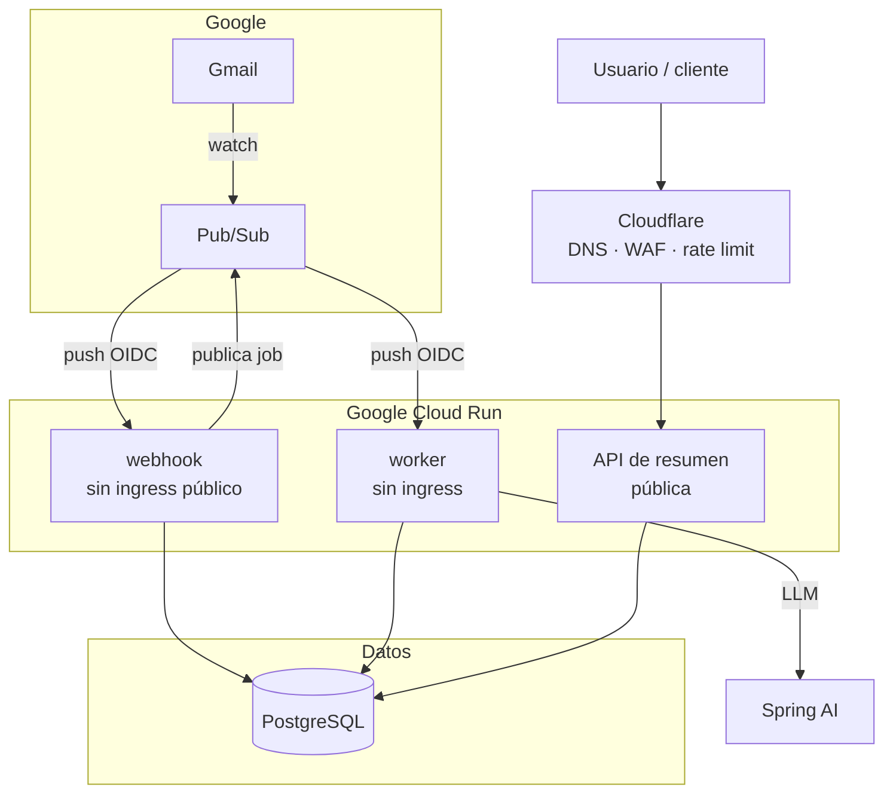
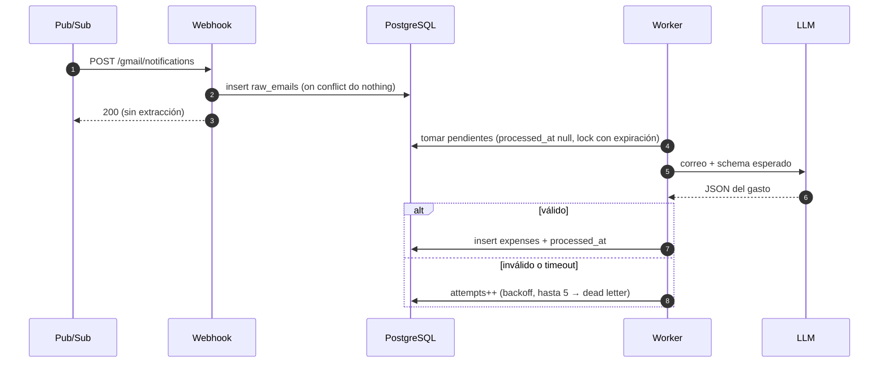
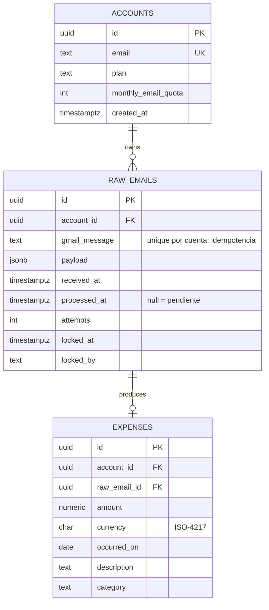

# Arquitectura

Este documento describe **cómo está armado** el sistema. Las decisiones y su justificación viven en
[`decisions/`](decisions/); acá solo se describe el resultado.

## Contexto

## Flujo de un correo

## Modelo de datos

Notas que importan más que las columnas:

- **La clave de idempotencia es por cuenta**: `(account_id, gmail_message)` único.
- `attempts`, `locked_at` y `locked_by` existen para que un worker que muere no bloquee la fila.
- `payload` en `jsonb` guarda el correo completo: es el insumo de la reprocesabilidad y de las evals.

## Límites del sistema

- **Ingesta**: un correo cada pocos segundos por cuenta; picos de ráfaga al abrir el correo, no
  tráfico masivo.
- **Extracción**: 1 llamada al LLM por correo, con timeout de 20 s y circuit breaker.
- **Retención**: `raw_emails` se purga a los 90 días (ver ADR 0007).
- **Consistencia**: eventual entre ingesta y gasto visible; el usuario no necesita lectura inmediata.
